# EverCity - dokumentáció

### Bevezetés

> A feladat egy egyjátékos, tycoon jellegű játék, egy valósidejű város építő szimulátor megvalósítása.

### A játék rövid leírása

> A játékos egy jól körülhatárolt területet kap, amely négyzetalakú mezőkből áll.Ezen a területen építheti fel a játékos a saját városát és menedzselheti azt egy szélesjogkörökkel bíró polgármesterként. A város leegyszerűsítve a különböző típusú zónákból (amelyeken a lakók automatikusan építkeznek), a játékos által külön megépítendő kiszolgálóépületekből és az ezeket összekötő utakból áll. A játékos célja, hogy virágzó várost fejlesszen, ahol a polgárok boldogok és a költségvetés kiegyensúlyozott. 
> 
> A kezdeti város építésére a játékos kap egy kezdőtőkét, azonban a további fejlesztésekhez a helyi adóbevételekre kell támaszkodnia. A játékot valósidejűként kell elkészíteni, de a valósághoz képest természetesen az idő jóval gyorsabban fog telni. A játék jelezze ki az időt (év,hónap,nap), és legyen lehetőség a játékot 3 különböző sebességben játszani, valamint a szüneteltetni is. 
> 
> A kész játéknak minimálisan felülnézeti 2dimenziós grafikával kell rendelkeznie, ahol az egyes mezőket statikus képek reprezentálják. Többlet feladatként készíthető haladóbb grafikai megoldás is.

### Osztálydiagram

> Az osztálydiagram megtalálható a Wiki oldalon.

### A játék működése

> - A játék megnyitásakor a következő képernyő fogad, ahol tudunk új játékot kezdeni, betölteni egy korábbi mentést, vagy kilpni a játékból.

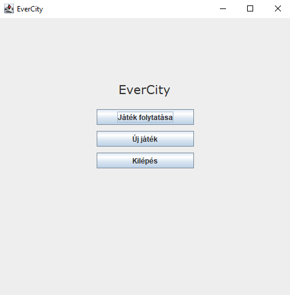
> 
> - Ha rákattintunk egy zónára bal oldalon láthatjuk az információkat róla.

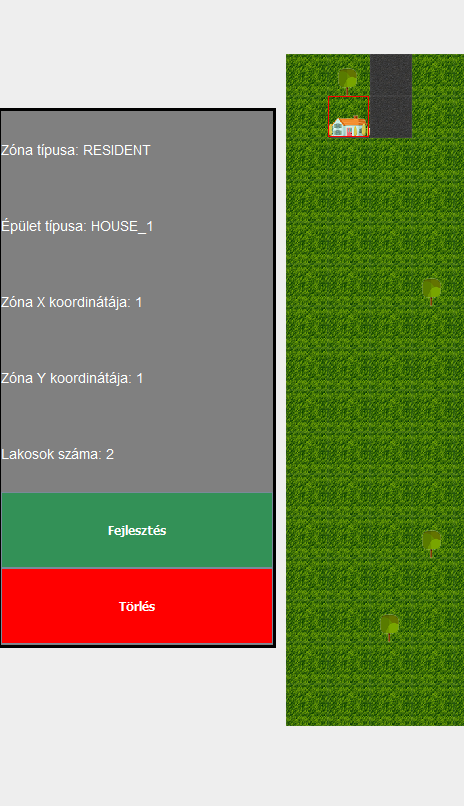
> 
> - A 'TOGGLE' gombra kattintva tudunk váltani, hogy zónát vagy épületet szeretnénk lehelyezni.

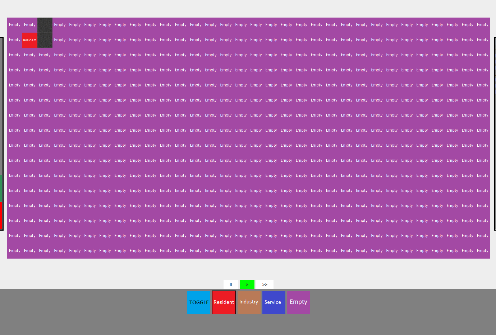
> 
> - Ha kiválasztunk egy zónát vagy épületet, arra kattintva kiválasztjük azt, majd rákattintva a négyzetre ahova szeretnénk letenni lehelyeződik oda.

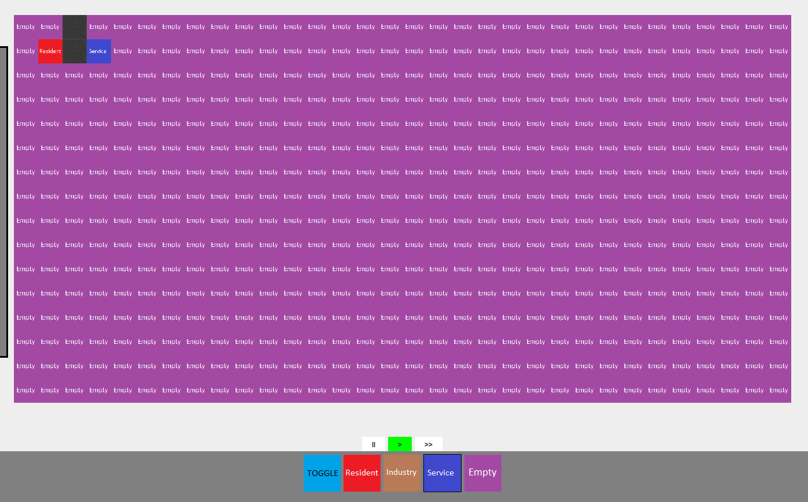
> 
> - A 'Menü' pontban a 'Nyelv'/'Language' menüpont alatt tudjuk váltani, hogy angol vagy magyar nyelven jelenjenek meg az információk a játékról.

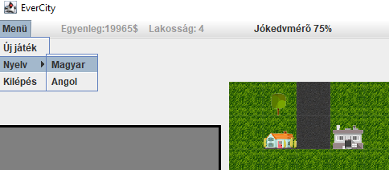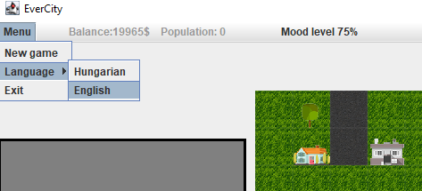
> 
> - A játéktábla alatti '||' gombra kattintva meg tudjuk állítani az időt, '>>' gombra kattintva fel tudjuk gyorsítani az időt, '>' gombra kattintva pedig vissza tudjuk állítani az alap gyorsaságra az időt.

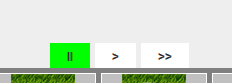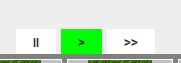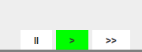
 - Egy lakóépületre kattintva a képernyő jobb oldalán megjelenik egy görgethető felsorolás az abban az épületben lakók adatairól.

 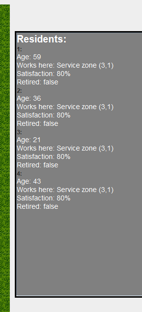
  - A képernyő alján különböző épületek találhatóak, ezekre kattintva helyezhetjük le a játéktáblára őket.

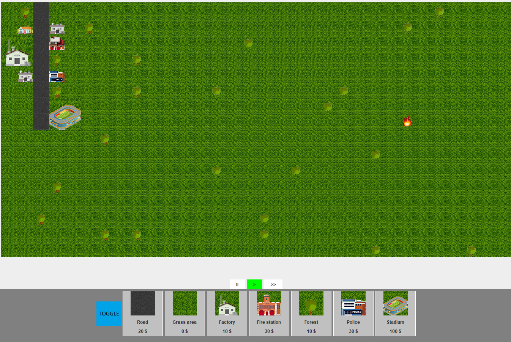
   - Egy lakó/szolgáltatási/ipari épületre kattintva bal oldalt az információs ablakban megjelenik egy fejlesztés gomb, erre kattintva fejleszthető az adott épület.
   
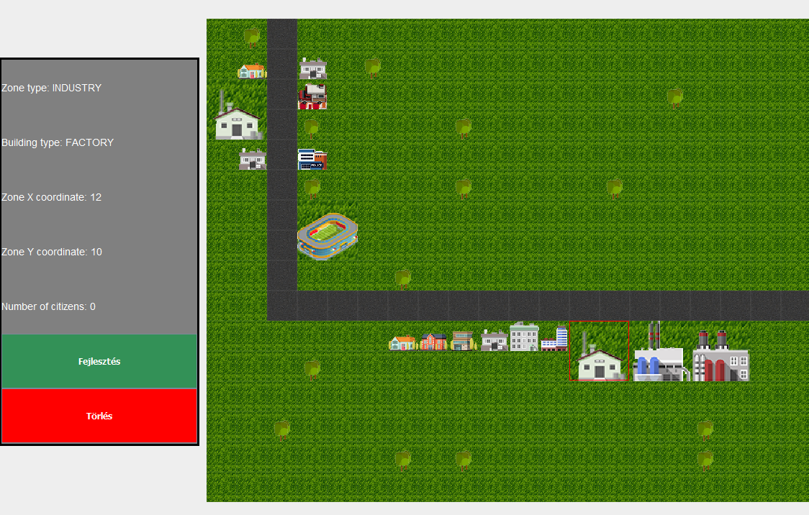
